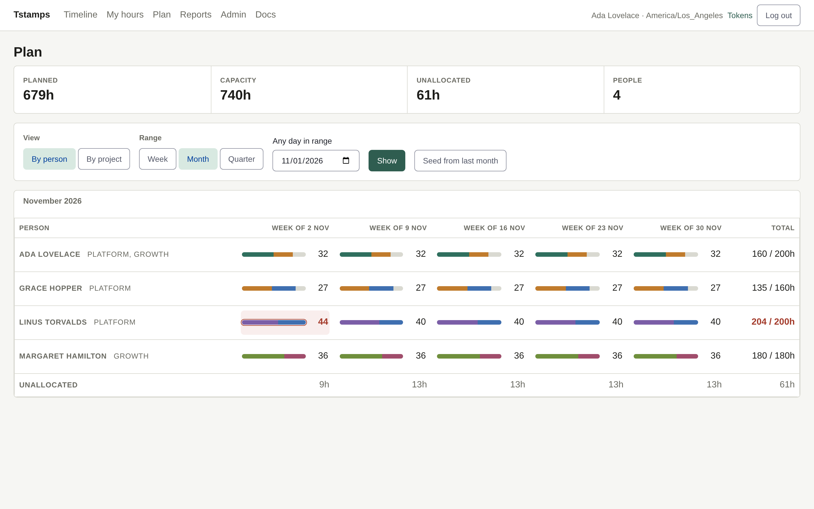
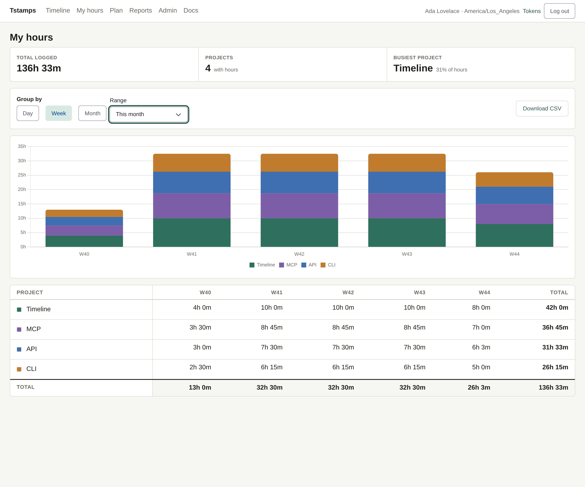
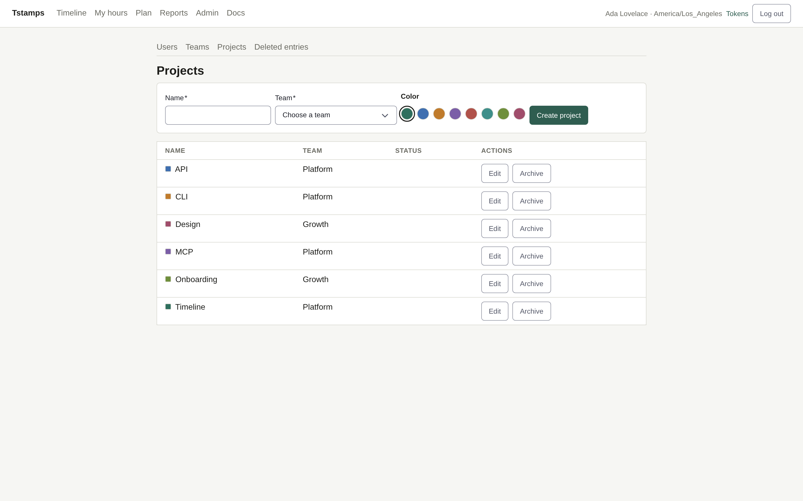
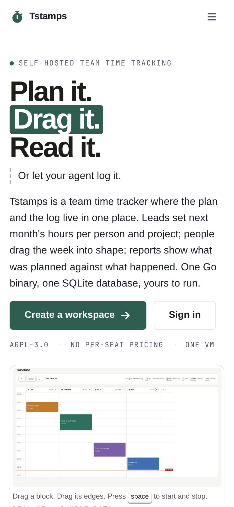

# Homepage — design document

Status: agreed direction, implemented at `/` for every visitor. Second edition.
Owner: web. Date: 2026-10-24, revised 2026-10-30.

## 1. What we are selling

Tstamps is team time tracking for one company per workspace, self-hosted by the
team that uses it, with a managed/hosted option to come. The product now covers
the whole week, not only the gesture that logs it:

> **Plan it. Drag it. Read it.**
> Or let your agent log it.

The distinctive idea is that the plan and the log live in one place. A lead can
say "Ana, 20 hours on Billing in W46", the team logs the week on a timeline, and
the report shows the hours logged against the plan. Planning tools and tracking
tools are separate products reconciled in a spreadsheet; Tstamps is one binary
with one SQLite database. A plan is never counted as logged time (ADR-0022), so
drift stays believable.

Three audiences, one page:

- the **person logging** — the timeline and My hours;
- the **lead** — the plan board and reports with drift;
- the **operator** — one binary, several workspaces, a file-copy backup.

### Goals

1. A visitor understands what Tstamps is, who it is for and what it is not, in
   under 20 seconds.
2. The product is shown, not described: every claim below is carried by a real
   screenshot or a real command.
3. A person with a workspace knows exactly where to sign in; a person without
   one knows they can self-host it for one company or several, and that a
   managed option is announced but not available yet.
4. It loads with the same static SPA: no external fonts, trackers, CDNs or
   server-side rendering.
5. It feels like Tstamps: paper-warm, quiet, precise, with project colour as the
   only decoration.

### Non-goals

- No pricing table, no “Book a demo”, no invented customer logos or quotes.
- No sign-up flow without email configured. A server with email set up offers
  self-service signup ([ADR-0014](../adr/0014-self-service-workspace-signup.md)):
  the page shows "Create a workspace", and `/signup` explains when the server
  has it switched off.
- No hosted-availability claim. The managed path is marked “coming soon” and
  links only to the GitHub repository: no price, uptime figure, waitlist, signup
  flow, email address or launch date.
- No marketing claims the specification cannot keep: approvals, leave and
  holidays, invoicing and rates, SSO, billing, a mobile app, reminders,
  realtime co-editing. The audit log is shipped, so it is no longer in that
  list.
- No claim that a plan is a schedule, a forecast or a budget. It is weekly
  hours a lead intends, against capacity.
- No claim that an agent writes without confirmation. The shipped skill
  proposes entries and writes only after the person confirms.
- No separate landing app or static-site build.

### The managed option

The product owner wants both deployment paths on the page: self-hosted, and
managed by us. Nothing in this repository implements or operates a managed
service, so the page presents it as a direction, not an offer — the third item
in the self-host section reads “Hosted by us — coming soon” and its only link is
the public GitHub repository. When a managed service exists, that item becomes a
real CTA and this section records the change.

## 2. Evidence: the product as it is today

These screenshots were captured from a demo workspace running the current
server: four people, two teams, six projects, a month of entries, plans for the
current and the next month, and one running entry. They are the visual source of
truth; the landing page reuses crops of the real UI rather than drawing a
prettier fake.

### Timeline — the core screen


What works: the lane-per-project layout is immediately readable; project colour
does the wayfinding; the boxes are the interface, not decoration. The toolbar
carries the gestures (`Drag on a lane to log · Alt for 1-minute steps · space
start/stop · n new · Delete remove · Esc cancel`), and the running entry shows
the stop control and the now line.

What the homepage must preserve: the block shapes, the green `#2f5f4e`, the
paper background, the mono timestamps, and the sense of a workday laid out
vertically.

### Plan — the forward half of the week



One row per person, one column per ISO week, a stacked bar of planned projects
in their timeline colours, capacity and unallocated hours at the edges. Linus is
planned 44 hours in a 40-hour week and is marked, not blocked. The board is the
evidence for "Plan it" and for the claim that over-capacity is shown rather than
refused.

### Reports — the reason a lead opens it


Projects as rows, ISO weeks as columns, a total on the right and a grand total at
the bottom. Each week cell shows the hours logged with the difference from the
plan below it; a project that was planned but logged nothing keeps a `0m` row
with its negative drift. This is the evidence for "Read it".

### My hours — every role gets their own



One bar per week, stacked by project in the project's own colour, over the same
project × bucket table with a total column and CSV. The chart is the page's
accessible copy: a screen reader reads the table. This is the evidence for
"everyone gets their own hours".

### Admin — the workspace is yours



Dense, utilitarian, no settings maze. The project table shows the same project
colours the timeline and the plan board use. Kept out of the homepage except as
a supporting claim (“users, teams and projects live in the same binary”).

### Sign in — the only door


The homepage must hand off to this screen without a second identity system.

### Narrow viewport — known constraint


The app shell is desktop-first: the header and the report table overflow at
390px. This is out of scope for the homepage change, but the homepage itself is
fully responsive and does not pretend the app is a mobile product.

## 3. Visual direction

**Concept: the paper ledger with a live timeline.** Warm paper, fine rules,
monospace time labels, one deep green and the project colours. The page is laid
out like a well-kept record: generous margins, short lines, no cards inside
cards. The only large images are the product itself.

### Tokens (reuse the app, add nothing global)

| Role | Value | Use |
| --- | --- | --- |
| Paper | `#f6f6f3` | page background |
| Surface | `#ffffff` | screenshot frames, code block |
| Ink | `#1d1d1a` | headings and body |
| Muted | `#6b6b63` | supporting copy, labels |
| Rule | `#d9d9d1` | borders, section rules |
| Accent | `#2f5d50` | CTAs, links, highlights |
| Accent deep | `#24483e` | hover |
| Night | `#1c352d` | self-host section |
| Project colours | `#2f6f5e`, `#3f6fb0`, `#c07b2c`, `#7b5ea7`, `#b0524a`, `#3f8f8a`, `#6f8f3c`, `#a04d6b` | swatches, small accents |

Type: the app's `system-ui` stack throughout. Display sizes use weight 650 and
tight tracking (`-0.045em`), not a new webfont. Labels use `ui-monospace` at
0.75rem, uppercase, 0.08–0.11em tracking. This is the timestamp language of the
product.

Shape: 6px radius on controls and screenshots, 10px on the hero frame. One
shadow only, under the hero image (`--wa-shadow-xl`).

Motion: a single 500ms rise on the hero copy and image, and a slow pulse on the
“recording” dot. Disabled under `prefers-reduced-motion`.

### Image treatment

- Hero: a 2× WebP crop of the timeline page — title, date bar and the four
  lanes — 2200×1260, 33 KB. It is the real UI, no invented chrome.
- Plan: a 2× WebP of the plan board with its summary and toolbar, 2048×956,
  46 KB, lazy loaded.
- Reports: a 2× WebP of the reports table, 2048×1057, 63 KB, lazy loaded.
- My hours: a 2× WebP of the stacked chart, 2048×519, 11 KB, lazy loaded.
- Screenshots sit in a white `padding: 2px` frame with a hairline border, like a
  print in a mat. No tilt, no faux browser chrome, no gradient overlays.
- There is no hand-positioned annotation tag: the timeline's own toolbar says
  “Drag on a lane to log”, so a second label would only repeat it.

## 4. Page anatomy

```
┌──────────────────────────────────────────────────────────────┐
│ skip link                                                     │
│ Tstamps   Plan  Reports  Agents  Self-host  Docs    [Sign in] │
├──────────────────────────────────────────────────────────────┤
│ SELF-HOSTED TEAM TIME TRACKING                               │
│ Plan it.                                                      │
│ Drag it.                  ┌───────────────────────────────┐  │
│ Read it.                  │  real timeline crop           │  │
│ Or let your agent log it. │  toolbar + four lanes         │  │
│                           └───────────────────────────────┘  │
│ Three sentences…                                              │
│ [Create a workspace] [Sign in]                                │
│ AGPL-3.0 · No per-seat pricing · One VM                       │
├──────────────────────────────────────────────────────────────┤
│ 01 PLAN                       ┌────────────────────────────┐  │
│ The plan is a board.          │ plan board screenshot      │  │
│ By person or project,         └────────────────────────────┘  │
│ capacity, seed, frozen weeks                                  │
├──────────────────────────────────────────────────────────────┤
│ 02 REPORTS                    ┌────────────────────────────┐  │
│ The report is the meeting.    │ reports screenshot         │  │
│ Logged minus planned.         └────────────────────────────┘  │
│ Every role also gets My hours: their own chart, table, CSV.   │
│ ┌──────────────────────────────────────────────────────────┐  │
│ │ my hours chart                                            │  │
│ └──────────────────────────────────────────────────────────┘  │
├──────────────────────────────────────────────────────────────┤
│ 03 AGENTS          ┌──────────────────────────────────────┐    │
│ Hand it to your    │ mcp.json: the workspace /mcp URL     │    │
│ agent.             └──────────────────────────────────────┘    │
├──────────────────────────────────────────────────────────────┤
│ NIGHT SECTION: Yours to run.                                  │
│ One binary · one SQLite database · no containers │            │
│ One company · several companies · hosted by us (coming soon)  │
│ [install commands]                                            │
├──────────────────────────────────────────────────────────────┤
│ Deliberately small.                                           │
│ Two columns: what it does / what it leaves out.               │
├──────────────────────────────────────────────────────────────┤
│ Open your workspace.                            [Sign in]     │
│ AGPL-3.0 · GitHub · Spec · Glossary · Decisions               │
└──────────────────────────────────────────────────────────────┘
```

### Copy (final)

**Hero**

- Eyebrow: `SELF-HOSTED TEAM TIME TRACKING`
- H1: `Plan it.` / `Drag it.` / `Read it.` — “Drag it.” sits in an accent block,
  shaped like a timeline entry.
- Agent line: `Or let your agent log it.` — a link to `#agents`, set off by a
  dashed rule like a draft block.
- Body: “Tstamps is a team time tracker where the plan and the log live in one
  place. Leads set next month's hours per person and project; people drag the
  week into shape; reports show what was planned against what happened. One Go
  binary, one SQLite database, yours to run.”
- Primary: `Create a workspace`, leading to `/signup`; the page says when the
  server has signup switched off.
- Secondary: `Sign in`
- Trust line: `AGPL-3.0` · `No per-seat pricing` · `One VM`
- Figure caption: “Drag a block. Drag its edges. Press `space` to start and
  stop.” and `REAL UI · SAMPLE DATA`.

**Plan**

- Label: `01 — Plan`
- Heading: `The plan is a board.`
- Body: “Leads set how many hours each person will spend on each project, week
  by week, against the hours they can work. A bar is coloured by project; over
  capacity is marked, not blocked, because a crunch is the thing you came to
  see. Seed a month from last month's hours, or repeat a week.”
- Detail list: “By person or by project, week by week” · “Capacity per person,
  40h by default” · “Past weeks frozen; current and future writable” · “A plan
  is never counted as logged time”.
- Caption: `NOVEMBER · 4 PEOPLE · ONE WEEK OVER CAPACITY`.

**Reports**

- Label: `02 — Reports`
- Heading: `The report is the meeting.`
- Body: “Leads read every hour booked on their team's projects, by person and by
  day, week or month. On week and month columns each cell shows the hours logged
  against the plan. There is no form to chase and no separate analytics tool to
  reconcile. Export the same rows as CSV.”
- Detail list: “Logged minus planned on every week” · “The entry's timezone
  decides its day” · “Archived projects keep their hours” · “Read-only, scoped
  to the teams you lead”.
- Caption: `OCTOBER · BY WEEK · LOGGED AGAINST PLANNED`.
- My hours note: “Every role also gets **My hours**: their own chart, table and
  CSV. The team-wide table stays with the lead.”
- Chart caption: `MY HOURS · OCTOBER · ONE BAR PER WEEK, STACKED BY PROJECT`.

**Agents**

- Label: `03 — Agents`
- Heading: `Hand it to your agent.`
- Body: “`tstamps mcp` runs locally; any MCP client can also connect to
  `/w/{slug}/mcp` over OAuth 2.1. Either way the agent acts as the person who
  approved it: scopes narrow what it can do, never widen it, and you can revoke
  the grant on `/tokens`.”
- Second paragraph: “The shipped skill proposes entries from your calendar or
  the agent's session history, and writes only after you confirm.”
- Links: `Install the agent skill` (GitHub) and `Read the MCP guide` (`/docs/mcp`).
- Card: a `mcp.json` client configuration pointing at
  `https://time.example.com/w/example.com/mcp`.

**Self-host**

- Label: `Self-hosted, or hosted by us`
- Heading: `Yours to run.`
- Body: “One `tstamps-server` process on one VM, behind Caddy on the same host.
  Run it for a single company, or host several: each workspace has its own users
  and projects, scoped inside the same SQLite database. Backups use `VACUUM
  INTO` and are safe while the server is running. The manual and the API
  reference ship inside the binary.”
- Paths, in order:
  - `One company.` — one workspace, one SQLite database, one admin created from
    the CLI.
  - `Several companies.` — one workspace per company, each with its own users
    and logins, all in one SQLite database. Operators invite companies, or turn
    on self-service signup with their own email provider.
  - `Hosted by us.` — coming soon; we run the same binary and the same shared
    database. Link: `Follow along on GitHub` (the repository is the only thing
    that exists).
- Facts: `One binary`, `One SQLite database`, `No containers`.
- Commands: the release download and `tstamps login`.

**Deliberately small**

- Heading: `Deliberately small.`
- Intro: “Tstamps is not trying to run your whole company. If you need the list
  on the right, choose something else — and that is the point.”
- Left (it does): timeline logging with one running entry · plan by person,
  project and week · reports with plan drift, and My hours · CLI, remote MCP and
  an agent skill · entry timezones that decide the day · audit log of role-based
  changes · several workspaces, one database.
- Right (it does not): approvals, leave and holidays · invoicing and rates · SSO,
  billing and a mobile app · reminders and notifications · realtime co-editing.
- Footer of section: “What it does and does not do is in the specification.”

**Close**

- Heading: `Open your workspace.`
- Body: “If your server is already running, the timeline is one sign-in away.”
- Primary: `Sign in`. Secondary: `Read the specification`.

**Footer**

`Tstamps` · Docs · GitHub · Specification · Glossary · Decisions · AGPL-3.0 ·
Built with Go and Svelte.

## 5. Responsive behaviour

- `≥ 60rem`: two-column hero, plan and reports splits, agents split reversed.
- `< 60rem`: hero stacks with the image after the CTAs; nav links collapse to
  brand + sign in; feature rows stack; the night section keeps its inset.
- `< 40rem`: H1 `clamp(2.5rem, 12vw, 3.5rem)`; code blocks scroll horizontally;
  all touch targets at least 44px.
- Verified: no horizontal overflow at 320, 390, 768, 1024 or 1440 CSS px.



## 6. Accessibility and performance

- Landmark structure: one `header`, one `main`, one `footer`, labelled nav.
- The hero image has descriptive alt text; the plan, reports and My hours images
  are lazy and have their own dimensions to avoid layout shift.
- Colour contrast: ink on paper 13.9:1; muted on paper 5.2:1; white on accent
  7.4:1. The accent block behind “Drag it.” uses white text.
- Focus: the app's 2px accent ring (`a:focus-visible`, 2px offset). The agent
  line is a real link to `#agents`, so it is reachable by keyboard.
- Motion respects `prefers-reduced-motion`.
- The shell paints immediately: `/` renders without waiting for the session
  check, so there is no blank frame while `/me` is in flight. The page has no
  data and makes no API call of its own; the only request is that background
  session check, which answers 401 for an anonymous visitor.
- The homepage adds no dependency of its own — it is Svelte and CSS. The bundle
  it ships in already carries Web Awesome and Lit (see ADR 0010).
- ~145 KB of images (WebP), served from the embedded SPA. No external requests.

### SEO and indexing

- `web/index.html` carries the title, description, canonical, Open Graph and
  Twitter card tags as static markup, so a crawler or a link unfurler sees them
  without running JavaScript. `Home.svelte` then swaps in its own shorter title
  once it mounts. The `<noscript>` block is a one-paragraph product summary plus
  the four moves, so a no-JS visitor still reads what Tstamps is, how it is run
  (one company or several workspaces) and that the managed option is not
  available yet.
- `/robots.txt` allows `/` and disallows `/login`, `/password`, `/signup`,
  `/timeline`, `/reports`, `/admin/` and `/api/`, and points at the sitemap.
- Only `/` is meant to be indexed. `web/embed.go` sends
  `X-Robots-Tag: noindex, nofollow` on client-route fallbacks and leaves `/` and
  real static files alone, so a deep link does not put someone's hours in a
  search result.
- `/sitemap.xml` is generated per request rather than checked in, because the
  deployment origin differs per install. It lists only `/`, the public
  homepage. The same handler builds `robots.txt` so its `Sitemap:` line carries
  the right origin; both live in `internal/api/server.go`.
- This is not server-side rendering or prerendering. The marketing content is
  still client-rendered; the static tags and the noscript block cover the
  crawl-and-unfurl case, not the no-JS case.

## 7. Implementation notes

- Route `/` → `web/src/pages/Home.svelte`, styles scoped to that component.
  Sections carry `id="plan"`, `id="reports"`, `id="agents"`, `id="self-host"`;
  the header and the mobile drawer link to them.
- Signup: `/signup` and `/signup/verify` → `Signup.svelte` and
  `SignupVerify.svelte`, both rendered inside the shell. They call the
  root-level signup API with `fetch`, because those routes are not in the
  workspace OpenAPI document.
- `App.svelte` renders `Home` without the app header/main. `/` does not wait for
  the session check or the route guard: it renders on first paint for everyone.
  Every other route still waits for the check, and a signed-out visitor on any
  of them lands on `/login`.
- A signed-in visitor stays on `/`; the sign-in CTAs are `Link` components, so
  they route client-side to `/login`, where the existing guard forwards a
  signed-in user on to `/w/{slug}/timeline`.
- Assets in `web/public/screenshots/` (Vite copies them into `web/dist` and
  `go:embed` carries them). The manual reuses `reports.webp` and now
  `plan.webp` and `my-hours.webp` in `docs/guide/`.
- The page is public: no data, no page API call, no session requirement. The
  background `/me` check is the only request.
- E2E: the homepage test asserts the H1 says “Plan it”, the static SEO markup,
  `robots.txt`, `sitemap.xml` and the `X-Robots-Tag` split, and that `Sign in`
  reaches the login screen. The hosted test asserts the same H1 on a hosted
  server. The signed-in walk still logs an entry, reads the report and downloads
  the CSV.
- Design screenshots live in `docs/design/screenshots/` and are not shipped.

## 8. Acceptance

- [ ] `/` explains plan, log, read and the agent path in one screen at 1440×900.
- [ ] No layout overflow at 320, 390, 768, 1024 or 1440 CSS px.
- [ ] Keyboard: skip link, focus visible, every anchor reachable, `#agents`
      reachable from the hero.
- [ ] Lighthouse: no contrast or landmark failures; CLS < 0.05; images < 150 KB
      each.
- [ ] Anonymous `/` renders with no uncaught JS errors (the expected anonymous
      `/me` 401 is the only failed request).
- [ ] Signed-in `/` renders the homepage; `Sign in` reaches `/timeline`.
- [ ] `/` offers `Create a workspace`, which reaches `/signup`; when the
      server has no email configured, submitting says signup is not enabled and
      creates nothing.
- [ ] The plan section claims only what ADR-0022 allows: weekly hours per person
      and project, capacity, seed and repeat, frozen past weeks, over-capacity
      marked, a plan never counted as logged time.
- [ ] The reports section shows drift on week and month columns and a `0m` row
      for a planned project with no hours.
- [ ] My hours is claimed for every role, as a chart, a table and a CSV.
- [ ] The agent section claims remote MCP over OAuth 2.1, revocable grants, and
      a skill that proposes and asks before writing. It does not claim silent
      logging.
- [ ] The scope list leaves out approvals/leave, invoicing, SSO, billing, mobile,
      reminders and realtime co-editing, and does not list the audit log as
      missing.
- [ ] The self-host section covers all three paths — one company, several
      companies as separate workspaces, and hosted by us — and the managed path
      is marked coming soon with no price, uptime, signup or email claim; its
      only link is the GitHub repository.
- [ ] `web/index.html` ships title, description and canonical (plus Open Graph
      and Twitter card) as static markup, with a `<noscript>` product summary.
- [ ] `/robots.txt` answers 200, allows `/` and disallows `/login`, `/password`,
      `/timeline`, `/reports`, `/admin/` and `/api/`, and its `Sitemap:` line is
      the request origin.
- [ ] `/sitemap.xml` answers 200, is valid XML, and its only `<loc>` is the
      request origin's `/`.
- [ ] `/` and real static files answer without `X-Robots-Tag`; client routes
      answer `X-Robots-Tag: noindex, nofollow`.

## 9. Result

The implementation, captured after the build:


