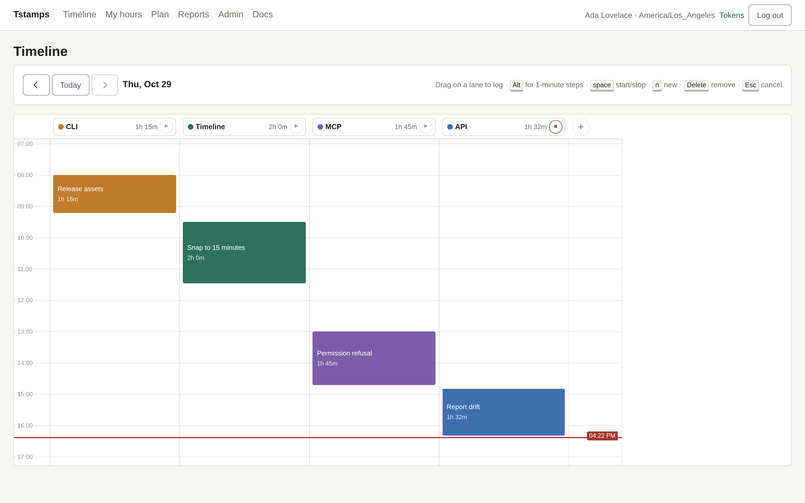
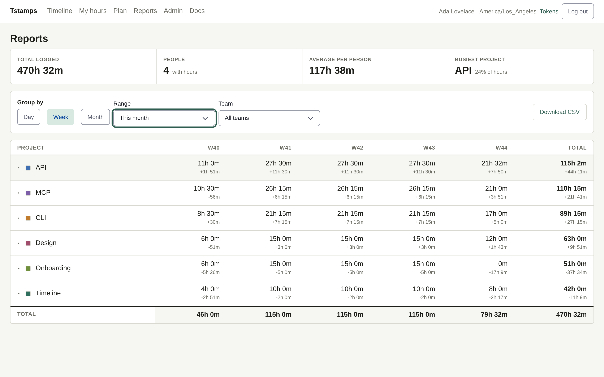
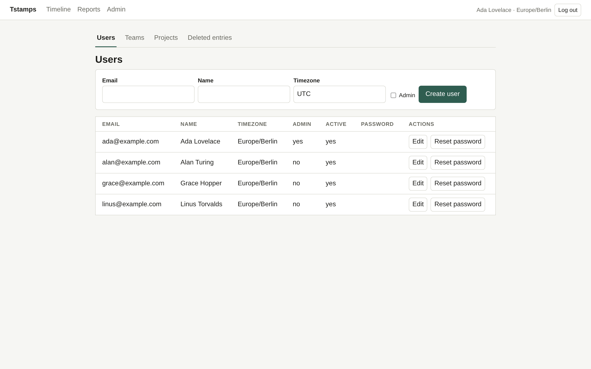
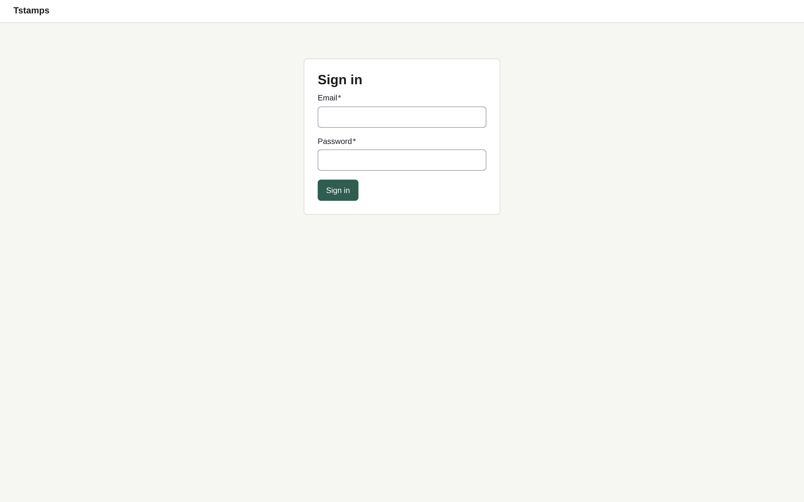
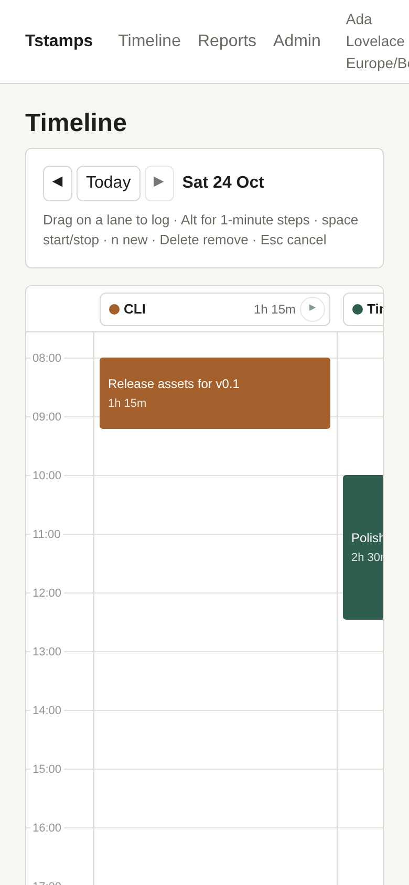
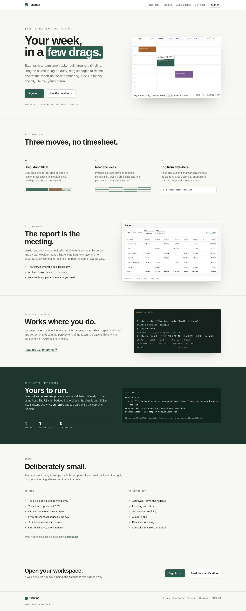

# Homepage — design document

Status: agreed direction, implemented at `/` for every visitor.
Owner: web. Date: 2026-10-24.

## 1. What we are selling

Tstamps is team time tracking for one company per workspace. It is self-hosted
by the team that uses it, with a managed/hosted option to come. The product's
distinctive idea is small enough to say in one sentence:

> A week of hours is a few drags, not a Friday form.

The homepage has to make that idea visible before asking for a login. It is
**not** a dashboard and it is not a second product: it is the front door of the
same single binary, served to everyone, signed in or not.

### Goals

1. A visitor understands what Tstamps is, who it is for and what it is not, in
   under 20 seconds.
2. The timeline is shown, not described. The hero contains the real interface.
3. A person with a workspace knows exactly where to sign in; a person without
   one knows that they can self-host it for one company or several, and that a
   managed option is announced but not available yet.
4. It loads with the same static SPA: no external fonts, trackers, CDNs or
   server-side rendering.
5. It feels like Tstamps: paper-warm, quiet, precise, with project colour as the
   only decoration.

### Non-goals

- No pricing table, no “Book a demo”, no invented customer logos or quotes.
- No sign-up flow. A workspace is bootstrapped by its admin (`admin create`);
  there is no self-service workspace signup.
- No hosted-availability claim. The managed path is marked “coming soon” and
  links only to the GitHub repository: no price, uptime figure, waitlist, signup
  flow, email address or launch date.
- No marketing claims the spec cannot keep (approvals, invoicing, SSO, mobile).
- No separate landing app or static-site build.

### The managed option

The product owner wants both deployment paths on the page: self-hosted, and
managed by us. Nothing in this repository implements or operates a managed
service, so the page presents it as a direction, not an offer — the third item
in the self-host section reads “Hosted by us — coming soon” and its only link is
the public GitHub repository. When a managed service exists, that item becomes a
real CTA and this section records the change.

## 2. Evidence: the product as it is today

These screenshots were captured from a demo workspace running the current
server, with four people, two teams and a week of entries. They are the visual
source of truth; the landing page reuses crops of the real UI rather than
drawing a prettier fake.

### Timeline — the core screen



What works: the lane-per-project layout is immediately readable; project colour
does the wayfinding; the boxes are the interface, not decoration. The drag
affordances and keyboard hints are present but quiet.

What the homepage must preserve: the block shapes, the 6px radius, the green
`#2f5d50`, the paper background, the mono-ish timestamps, and the sense of a
workday laid out vertically.

### Reports — the reason a lead opens it



The table is confident: one row per project, one column per day, total on the
right, grand total at the bottom. It is a record, not a dashboard. The landing
page should use this as evidence for “read the week without asking for a form”.

### Admin — the workspace is yours



Dense, utilitarian, no settings maze. Kept out of the homepage except as a
supporting claim (“users, teams and projects live in the same binary”).

### Sign in — the only door



The homepage must hand off to this screen without a second identity system.

### Narrow viewport — known constraint



The app shell is desktop-first: the header and the report table overflow at
390px. This is out of scope for the homepage change, but the homepage itself
must be fully responsive and must not pretend the app is a mobile product.

## 3. Visual direction

**Concept: the paper ledger with a live timeline.** Warm paper, fine rules,
monospace time labels, one deep green and the four project colours. The page is
laid out like a well-kept record: generous margins, short lines, no cards inside
cards. The only large image is the product itself.

### Tokens (reuse the app, add nothing global)

| Role | Value | Use |
| --- | --- | --- |
| Paper | `#f6f6f3` | page background |
| Surface | `#ffffff` | screenshot frames, code block |
| Ink | `#1d1d1a` | headings and body |
| Muted | `#6b6b63` | supporting copy, labels |
| Rule | `#d9d9d1` | borders, section rules |
| Accent | `#2f5d50` | CTAs, links, highlights |
| Accent deep | `#24483e` | hover |
| Night | `#1c352d` | self-host section |
| Project colours | `#a4602c`, `#3d6f8e`, `#7a5a8f`, `#8e6d3d` | swatches, small accents |

Type: the app's `system-ui` stack throughout. Display sizes use weight 650 and
tight tracking (`-0.04em`), not a new webfont. Labels use `ui-monospace` at
0.75rem, uppercase, 0.08em tracking. This is the timestamp language of the
product.

Shape: 6px radius on controls and screenshots, 10px on the hero frame. One
shadow only, under the hero image (`0 40px 80px -48px rgb(29 29 26 / 45%)`).

Motion: a single 500ms rise on the hero copy and image, and a slow pulse on the
“recording” dot. Disabled under `prefers-reduced-motion`.

### Image treatment

- Hero: a 2× WebP crop of `.lanes-scroll`, 2200×1402, 36 KB. It is the real
  timeline, no invented UI.
- Reports: a 2× WebP of the reports `<main>`, 2048×1138, 58 KB, lazy loaded.
- Screenshots sit in a white `padding: 6px` frame with a hairline border, like a
  print in a mat. No tilt, no faux browser chrome, no gradient overlays.
- A small hand-positioned tag (“drag to log”) is the only annotation.

## 4. Page anatomy

```
┌──────────────────────────────────────────────────────────────┐
│ skip link                                                     │
│ Tstamps   Timeline  Reports  CLI  Self-host        [Sign in]  │
├──────────────────────────────────────────────────────────────┤
│ SELF-HOSTED TEAM TIME TRACKING                               │
│ Your week,                                                    │
│ in a few drags.            ┌───────────────────────────┐      │
│                            │  real timeline crop       │      │
│ Three sentences…           │  [drag to log]            │      │
│                            └───────────────────────────┘      │
│ [Sign in] [See the timeline]                                  │
│ AGPL-3.0 · No per-seat pricing · One VM                       │
├──────────────────────────────────────────────────────────────┤
│ 01 THE LOOP                                                   │
│ Drag, don't fill in.  Read the week.  Log from anywhere.      │
│ three short columns, each with a small line visual            │
├──────────────────────────────────────────────────────────────┤
│ 02 REPORTS                       ┌─────────────────────────┐  │
│ The report is the meeting.       │ reports screenshot      │  │
│ By person, by day, CSV.          └─────────────────────────┘  │
├──────────────────────────────────────────────────────────────┤
│ 03 CLI + MCP          ┌────────────────────────────────────┐  │
│ Works where you do.   │ $ tstamps start Timeline           │  │
│                      └────────────────────────────────────┘  │
├──────────────────────────────────────────────────────────────┤
│ NIGHT SECTION: Yours to run.                                  │
│ One binary · one SQLite file per workspace · file-copy backup │
│ One company · several companies · hosted by us (coming soon)  │
│ [install commands]                                            │
├──────────────────────────────────────────────────────────────┤
│ Deliberately small.                                           │
│ Two columns: what it does / what it leaves out.               │
├──────────────────────────────────────────────────────────────┤
│ Open your workspace.                            [Sign in]     │
│ AGPL-3.0 · GitHub · Spec · Glossary · Decisions               │
└──────────────────────────────────────────────────────────────┘
```

### Copy (final)

**Hero**

- Eyebrow: `SELF-HOSTED OR HOSTED TEAM TIME TRACKING`
- H1: `Your week, in a few drags.` — “few drags” sits in an accent block, shaped
  like a timeline entry.
- Body: “Tstamps is a team time tracker built around a timeline. Drag on a lane
  to log an entry, drag its edges to retime it, and let the report do the
  remembering. Run it yourself for one company, or several as separate
  workspaces: one Go binary, one SQLite file per workspace. Hosted by us is
  coming.”
- Primary: `Sign in`
- Secondary: `See the timeline`
- Trust line: `AGPL-3.0` · `No per-seat pricing` · `One VM`

**The loop**

- Heading: `Three moves, no timesheet.`
- 01 `Drag, don't fill in.` — “Drag on a lane to log; drag an edge to retime;
  press space to start and stop. Overlaps are shown, not rejected.”
- 02 `Read the week.` — “Projects as rows, days as columns, biggest first. Open a
  project for one line per person, then take the CSV.”
- 03 `Log from anywhere.` — “A one-line CLI and an MCP server share the same API,
  so a terminal or an agent can start, stop and correct entries.”

**Reports**

- Label: `02 — REPORTS`
- Heading: `The report is the meeting.`
- Body: “Leads read every hour booked on their team's projects, by person and by
  day, week or month. There is no form to chase and no separate analytics tool
  to reconcile. Export the same rows as CSV.”
- Detail list: “Entry timezone decides the day”, “Archived projects keep their
  hours”, “Read-only for members”.

**CLI + MCP**

- Label: `03 — CLI & AGENTS`
- Heading: `Works where you do.`
- Body: “`tstamps start` is one line in a terminal. `tstamps mcp` lets an agent
  start, stop and correct entries with the permissions of the token you gave it.
  Both talk to the same HTTP API as the timeline.”
- Terminal card: install, login, start, stop, report.

**Self-host**

- Label: `Self-hosted, or hosted by us`
- Heading: `Yours to run.`
- Body: “One `tstamps-server` process on one VM, behind Caddy on the same host.
  Run it for a single company, or host several: each workspace is one SQLite
  file with its own users and projects. Backups use `VACUUM INTO` and are safe
  while the server is running.”
- Paths, in order:
  - `One company.` — one workspace, one SQLite file, one admin created from the
    CLI.
  - `Several companies.` — one workspace per company, each with its own SQLite
    file and its own logins. Operators create workspaces; there is no
    self-service signup.
  - `Hosted by us.` — coming soon; we run the same binary and the same
    per-workspace files. Link: `Follow along on GitHub` (the repository is the
    only thing that exists).
- Facts: `One binary`, `One SQLite file per workspace`, `No containers`.
- Commands: the release download and `tstamps login`.

**Deliberately small**

- Heading: `Deliberately small.`
- Intro: “Tstamps is not trying to run your whole company. If you need these,
  choose something else — and that is the point.”
- Left (it does): timeline logging · team-lead reports · CSV · CLI + MCP ·
  soft delete and restore · entry timezones · one company per workspace.
- Right (it does not): approvals or leave · invoicing and rates · SSO or audit
  log · mobile app · realtime co-editing · self-service workspace signup.
- Footer of section: “What it does and does not do is in the spec.”

**Close**

- Heading: `Open your workspace.`
- Body: “If your server is already running, the timeline is one sign-in away.”
- Primary: `Sign in`. Secondary: `Read the specification`.

**Footer**

`Tstamps` · AGPL-3.0-only · GitHub · Specification · Glossary · Decisions ·
Built with Go and Svelte.

## 5. Responsive behaviour

- `≥ 60rem`: two-column hero (`1.05fr / 0.95fr`), reports split 1:1.2.
- `< 60rem`: hero stacks, image after the CTAs; nav links collapse to brand +
  sign in; feature rows stack; the night section keeps its inset.
- `< 40rem`: H1 `clamp(2.5rem, 12vw, 3.5rem)`; code block scrolls horizontally;
  all touch targets at least 44px.

## 6. Accessibility and performance

- Landmark structure: one `header`, one `main`, one `footer`, labelled nav.
- The hero image has descriptive alt text; the reports image is lazy and has its
  own dimensions to avoid layout shift.
- Colour contrast: ink on paper 13.9:1; muted on paper 5.2:1; white on accent
  7.4:1. The accent block behind “few drags” uses white text.
- Focus: the app's 2px accent ring (`a:focus-visible`, 2px offset).
- Motion respects `prefers-reduced-motion`.
- The shell paints immediately: `/` renders without waiting for the session
  check, so there is no blank frame while `/me` is in flight. The page has no
  data and makes no API call of its own; the only request is that background
  session check, which answers 401 for an anonymous visitor.
- The homepage adds no dependency of its own — it is Svelte and CSS. The bundle
  it ships in already carries Web Awesome and Lit (see ADR 0010).
- ~100 KB of images (WebP), served from the embedded SPA. No external requests.

### SEO and indexing

- `web/index.html` carries the title, description, canonical, Open Graph and
  Twitter card tags as static markup, so a crawler or a link unfurler sees them
  without running JavaScript. `Home.svelte` then swaps in its own shorter title
  once it mounts. The `<noscript>` block is a one-paragraph product summary, so
  a no-JS visitor still reads what Tstamps is, how it is run (one company or
  several workspaces) and that the managed option is not available yet.
- `/robots.txt` allows `/` and disallows `/login`, `/password`, `/timeline`,
  `/reports`, `/admin/` and `/api/`, and points at the sitemap.
- Only `/` is meant to be indexed. `web/embed.go` sends
  `X-Robots-Tag: noindex, nofollow` on client-route fallbacks and leaves `/` and
  real static files alone, so a deep link does not put someone's hours in a
  search result.
- `/sitemap.xml` is generated per request rather than checked in, because the
  deployment origin differs per install. It lists only `/`, the public
  homepage. The same handler builds `robots.txt` so its `Sitemap:` line carries
  the right origin; both live in `internal/api/server.go`.
- This is not server-side rendering or prerendering. The marketing content is
  still client-rendered; the static tags and the noscript block cover the
  crawl-and-unfurl case, not the no-JS case.

## 7. Implementation notes

- New route `/` → `web/src/pages/Home.svelte`, styles scoped to that component.
- `App.svelte` renders `Home` without the app header/main. `/` does not wait for
  the session check or the route guard: it renders on first paint for everyone.
  Every other route still waits for the check, and a signed-out visitor on any
  of them lands on `/login`.
- A signed-in visitor stays on `/`; the three sign-in CTAs are `Link`
  components, so they route client-side to `/login`, where the existing guard
  forwards a signed-in user on to `/timeline`.
- Assets in `web/public/screenshots/` (Vite copies them into `web/dist` and
  `go:embed` carries them).
- The page is public: no data, no page API call, no session requirement. The
  background `/me` check is the only request.
- E2E, three Playwright tests: (a) `/` is public and ships its static SEO
  markup, `robots.txt`, `sitemap.xml` and the `X-Robots-Tag` split, and `Sign
  in` reaches the login screen; (b) a signed-in visitor gets the public `/`,
  then logs an entry, reads the report and downloads the CSV; (c) the admin
  controls bind — the Admin checkbox on user creation, and a team member's role
  set to lead and verified over the API.
- Design screenshots live in `docs/design/screenshots/` and are not shipped.

## 8. Acceptance

- [ ] `/` explains the product and the CTA in one screen at 1440×900.
- [ ] No layout overflow at 320, 390, 768, 1024 or 1440 CSS px.
- [ ] Keyboard: skip link, focus visible, every anchor reachable.
- [ ] Lighthouse: no contrast or landmark failures; CLS < 0.05; images < 150 KB.
- [ ] Anonymous `/` renders with no uncaught JS errors (the expected anonymous
      `/me` 401 is the only failed request).
- [ ] Signed-in `/` renders the homepage; `Sign in` reaches `/timeline`.
- [ ] The self-host section covers all three paths — one company, several
      companies as separate workspaces, and hosted by us — and the managed path
      is marked coming soon with no price, uptime, signup or email claim; its
      only link is the GitHub repository.
- [ ] `web/index.html` ships title, description and canonical (plus Open Graph
      and Twitter card) as static markup, with a `<noscript>` product summary.
- [ ] `/robots.txt` answers 200, allows `/` and disallows `/login`, `/password`,
      `/timeline`, `/reports`, `/admin/` and `/api/`, and its `Sitemap:` line is
      the request origin.
- [ ] `/sitemap.xml` answers 200, is valid XML, and its only `<loc>` is the
      request origin's `/`.
- [ ] `/` and real static files answer without `X-Robots-Tag`; client routes
      answer `X-Robots-Tag: noindex, nofollow`.

## 9. Result

The implementation, captured after the build:



